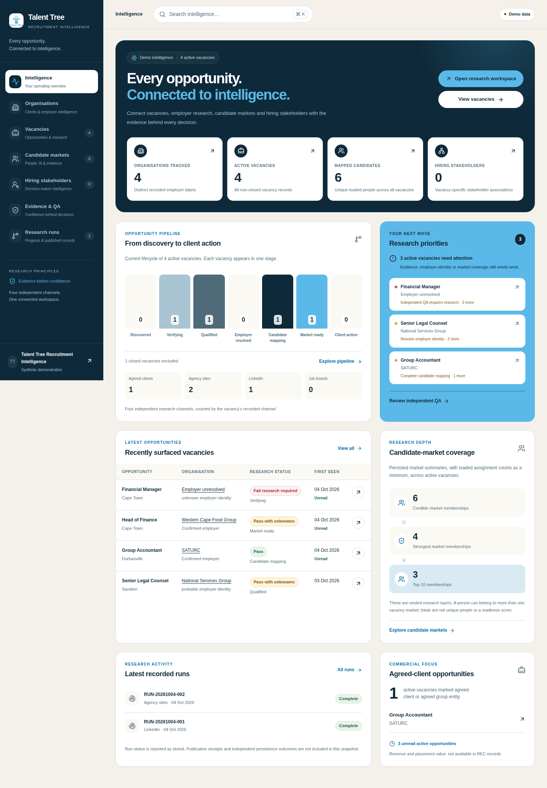
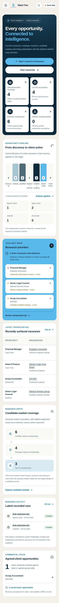

# Talent Tree brand correction and loading optimization

The 17 October 2026 user correction limits visual changes to the official Talent Tree palette and logo. The rebuilt composition, dimensions, typography, navigation and record workflows remain in place. `interface/design-system.md` supplies the official ink/navy/azure/warm-paper values; `public/talent-tree-logo-2026.png` supplies the unmodified artwork. Evidence, QA and workflow success, warning and error colors remain distinct.

## Loading changes

- Disable speculative prefetch on protected workspace links. The cold-browser trace previously recorded 13 background route requests on each measured page; it now records zero. This removes competing network/authentication work while the current page loads.
- Split candidate intelligence and organisation profiles into on-demand chunks. Each starts fetching a new script only when its record is opened. Deep links still render the selected record. Candidate loading has a dismissible modal with focus trapping and restoration.
- Load the vacancy stylesheet from the vacancy route, keeping it out of the other screens' initial styles.
- Defer and memoize candidate/organisation filtering; build global-search records only while search is open, reusing the index between keystrokes.
- Load the Supabase browser sign-in library when a sign-in action needs it. The fixed-size official logo uses a local image with reserved dimensions and no client image runtime.

No cross-user data cache, authentication changes, data truncation or database/schema changes are introduced.

## Measured evidence

Fresh production build; Chromium; synthetic demo; cold browser context for each route. Bytes are encoded response-body bytes from Resource Timing, not parsed bundle size. [Before trace](brand-correction/loading-before.json) and [after trace](brand-correction/loading-after.json) include all raw measurements.

| Route         | Speculative requests before → after | Initial CSS bytes before → after | Initial script bytes before → after |
| ------------- | ----------------------------------: | -------------------------------: | ----------------------------------: |
| Vacancies     |                              13 → 0 |                  10,292 → 10,915 |                   170,914 → 170,951 |
| Candidates    |                              13 → 0 |                   13,761 → 7,611 |                   159,919 → 156,798 |
| Organisations |                              13 → 0 |                   14,739 → 8,581 |                   159,152 → 156,264 |

Candidate CSS drops 44.7%; organisation CSS drops 41.8%. The vacancy route retains its own stylesheet. The loading regression test asserts no speculative route requests and verifies a new detail script loads when each record is opened.

Single-run local wall-clock times vary and do not establish a production latency improvement. The authenticated live dataset and Supabase response times were not profiled; the existing complete workspace loader remains unchanged. These measurements substantiate less background work and smaller initial directory styles/scripts.

## Verification

- `NEXT_PUBLIC_DEMO_MODE=true NEXT_TELEMETRY_DISABLED=1 npm run verify`: typecheck, lint, three contract smokes, eight regression checks, 106 unit tests and production build pass.
- `BROWSER_EXECUTABLE_PATH=/usr/bin/chromium npm run test:loading`: passes all three routes, including candidate/organisation chunk deferral.
- `BROWSER_EXECUTABLE_PATH=/usr/bin/chromium npm run test:browser`: 56 route/width combinations, 13 accessibility scans with zero violations, seven interaction groups and no page errors.
- Independent reviewer delayed the candidate chunk: loading and loaded dialogs trap keyboard focus, Escape restores the original trigger and scrolling, and closing while loading prevents reopening after the chunk resolves.

