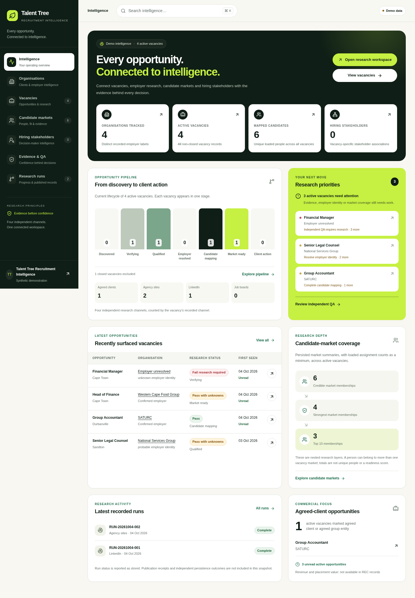

# Screenshot gallery

All REC captures use the existing synthetic demo. Reference captures are isolated synthetic fixtures; none were imported into REC’s data store. Desktop is 1440px and mobile is 375px. The automated report also checks 430, 768, 1024, 1280 and 1920px.

| Screen              | REC desktop                                    | REC mobile                                    | Reference desktop                                       | Reference mobile                                       |
| ------------------- | ---------------------------------------------- | --------------------------------------------- | ------------------------------------------------------- | ------------------------------------------------------ |
| Intelligence        | [View](screenshots/rec-intelligence-1440.png)  | [View](screenshots/rec-intelligence-375.png)  | [View](screenshots/reference-intelligence-desktop.png)  | [View](screenshots/reference-intelligence-mobile.png)  |
| Organisations       | [View](screenshots/rec-organisations-1440.png) | [View](screenshots/rec-organisations-375.png) | [View](screenshots/reference-organisations-desktop.png) | [View](screenshots/reference-organisations-mobile.png) |
| Vacancies           | [View](screenshots/rec-vacancies-1440.png)     | [View](screenshots/rec-vacancies-375.png)     | [View](screenshots/reference-vacancies-desktop.png)     | [View](screenshots/reference-vacancies-mobile.png)     |
| Candidate markets   | [View](screenshots/rec-candidates-1440.png)    | [View](screenshots/rec-candidates-375.png)    | [View](screenshots/reference-candidates-desktop.png)    | [View](screenshots/reference-candidates-mobile.png)    |
| Hiring stakeholders | [View](screenshots/rec-stakeholders-1440.png)  | [View](screenshots/rec-stakeholders-375.png)  | [View](screenshots/reference-stakeholders-desktop.png)  | [View](screenshots/reference-stakeholders-mobile.png)  |
| Evidence & QA       | [View](screenshots/rec-evidence-qa-1440.png)   | [View](screenshots/rec-evidence-qa-375.png)   | [View](screenshots/reference-evidence-desktop.png)      | [View](screenshots/reference-evidence-mobile.png)      |
| Research runs       | [View](screenshots/rec-runs-1440.png)          | [View](screenshots/rec-runs-375.png)          | No corresponding reference route                        | No corresponding reference route                       |
| Sign in             | [View](screenshots/rec-login-1440.png)         | [View](screenshots/rec-login-375.png)         | No corresponding reference route                        | No corresponding reference route                       |

## Record intelligence

| Detail                              | Desktop                                              | Mobile                                                                                                          |
| ----------------------------------- | ---------------------------------------------------- | --------------------------------------------------------------------------------------------------------------- |
| Organisation profile                | [View](screenshots/rec-organisation-detail-1440.png) | [View](screenshots/rec-organisation-detail-375.png)                                                             |
| Candidate intelligence              | [View](screenshots/rec-candidate-detail-1440.png)    | [View](screenshots/rec-candidate-detail-375.png)                                                                |
| Vacancy intelligence / confirmation | [Workbench](screenshots/rec-vacancies-1440.png)      | [Detail](screenshots/rec-vacancy-detail-375.png) · [Confirmation](screenshots/rec-vacancy-confirmation-375.png) |
| Run details                         | [View](screenshots/rec-run-detail-1440.png)          | Covered by responsive dialog rules and component checks                                                         |

The available REC demo has no hiring stakeholder records. Its honest empty state is captured; stakeholder/email details are covered by isolated component tests, rather than fabricated app records.

## Before and after

The before images capture the unfinished PR26 foundation before replacement. These comparisons demonstrate changed structure and composition, rather than a palette change.

| Screen            | Before                                             | Rebuilt                                        |
| ----------------- | -------------------------------------------------- | ---------------------------------------------- |
| Vacancies         | [Before](screenshots/before-vacancies-1440.png)    | [After](screenshots/rec-vacancies-1440.png)    |
| Intelligence      | [Before](screenshots/before-intelligence-1440.png) | [After](screenshots/rec-intelligence-1440.png) |
| Candidate markets | [Before](screenshots/before-candidates-1440.png)   | [After](screenshots/rec-candidates-1440.png)   |

