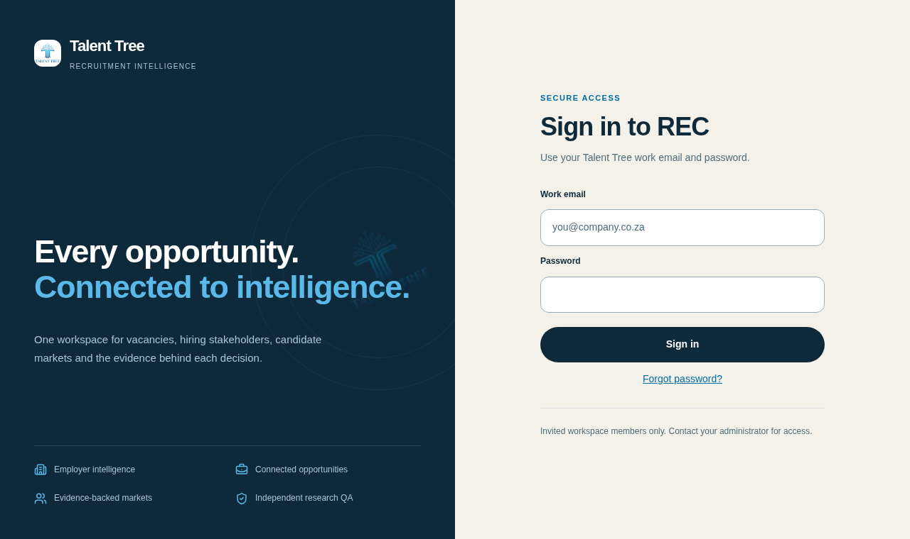
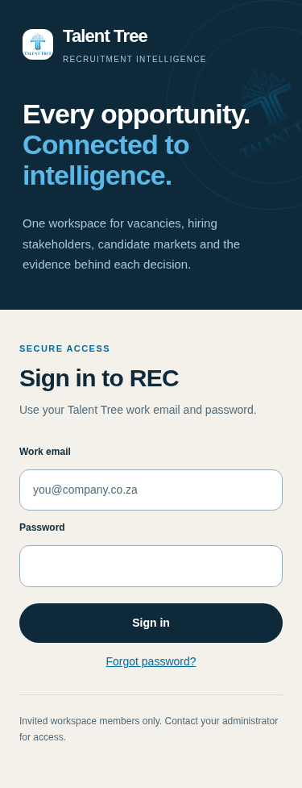

# Private-access verification — 17 October 2026

The change replaces OTP-only sign-in with invited-member email/password access and activates the proxy at the correct `src/proxy.ts` location. A production fixture exposed that the former root proxy was not in the build's middleware manifest. The final build explicitly reports `Proxy (Middleware)`.

## Fresh checks

- `NEXT_TELEMETRY_DISABLED=1 npm run verify`: exit 0; typecheck, lint, three contract smokes, eight product regressions, 130 unit tests across 19 files, production build.
- `BROWSER_EXECUTABLE_PATH=/usr/bin/chromium npm run test:auth-browser`: exit 0. Builds production with a deliberately enabled demo flag against a loopback-only synthetic Auth/PostgREST fixture and uses the real Supabase SDK. Anonymous HTML and RSC requests cannot retrieve the private workspace/record marker; operational APIs deny access. Invalid credentials, unverified/non-member accounts, cross-origin requests, missing reset keys, expired grants and known-session grant forgeries are covered by browser/unit checks.
- Browser member sign-in, cookie flags and JavaScript token isolation, lack of local token storage, ordinary-session password-update denial, multi-tab sign-out, recovery/setup and new-password sign-in pass.
- Four axe scans (desktop/mobile login, authenticated mobile workspace and password setup) report zero violations; mobile views do not overflow; no page errors.
- Independent review identified the original unkeyed reset-grant weakness. Final HMAC/HKDF server-key signing and a forgery regression test address it; reviewer confirmed the fix. The unit test verifies global sign-out is requested after password setup; the local fixture does not establish live provider-wide session revocation.

[Raw synthetic browser report](browser-report.json)

## Evidence boundaries

The fixture changes no live records or accounts and sends no real email. Live Supabase policies, migration application, invitation templates, redirect settings, storage/backup encryption and actual production-account sign-in have not been verified. Vercel CLI is logged out and provider API requests return an environment-proxy 403. The environment networking/startup draft is saved for user review; it still requires publishing. See [required live setup](../../PRIVATE_ACCESS.md).

An additional empty-workspace accessibility probe found the existing vacancy listbox has no required option children when the queue is empty (`aria-required-children` on `.vacancy-list`). That operational component is unchanged in this authentication task. The retained browser fixture tests a synthetic private vacancy and the new login/password states; this known empty-state issue is separate from the access gate.
